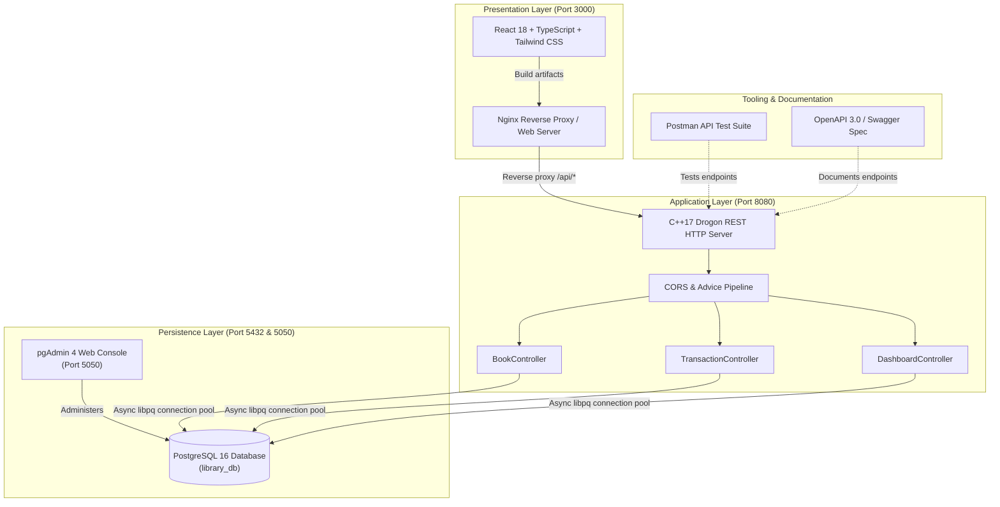
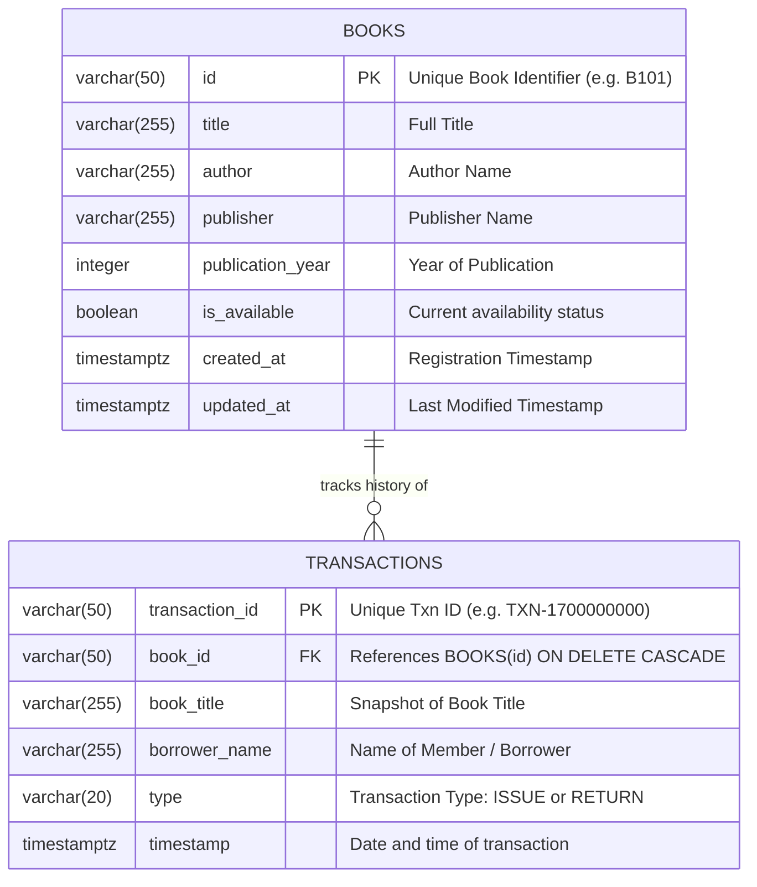

# Enterprise Architecture Documentation

This document describes the multi-tier enterprise architecture of the **Library Management System** implemented with React, C++17 Drogon, PostgreSQL, and Docker.

---

## 1. System Architecture Diagram

---

## 2. Database Entity-Relationship (ER) Diagram

---

## 3. Service Port Mapping

| Service | Technology | Port | Access URL | Credentials |
| :--- | :--- | :--- | :--- | :--- |
| **Frontend UI** | React + TypeScript + Tailwind | `3000` | `http://localhost:3000` | N/A |
| **Backend REST API** | C++17 + Drogon | `8080` | `http://localhost:8080/api` | N/A |
| **Database** | PostgreSQL 16 Alpine | `5432` | `localhost:5432` | User: `postgres`, Pass: `password`, DB: `library_db` |
| **DB Web Management**| pgAdmin 4 | `5050` | `http://localhost:5050` | Email: `admin@library.com`, Pass: `admin` |
| **API Specification**| Swagger / OpenAPI 3.0 | File | `docs/openapi.yaml` | N/A |
| **API Testing** | Postman Collection | File | `docs/Library_Management.postman_collection.json` | N/A |

---

## 4. REST API Endpoint Catalog

| HTTP Method | Route | Description | Request Body |
| :--- | :--- | :--- | :--- |
| `GET` | `/api/health` | Healthcheck endpoint | None |
| `GET` | `/api/dashboard/stats` | Overall statistics for dashboard cards | None |
| `GET` | `/api/books` | List books (supports `?search=` and `?status=`) | None |
| `GET` | `/api/books/{id}` | Retrieve individual book details | None |
| `POST` | `/api/books` | Create new book record | `{ id, title, author, publisher, year }` |
| `PUT` | `/api/books/{id}` | Update book details | `{ title, author, publisher, year }` |
| `DELETE` | `/api/books/{id}` | Delete book record | None |
| `POST` | `/api/transactions/issue` | Issue book to borrower | `{ bookId, borrowerName }` |
| `POST` | `/api/transactions/return`| Return an issued book | `{ bookId }` |
| `GET` | `/api/transactions` | Full chronological audit trail | None |

