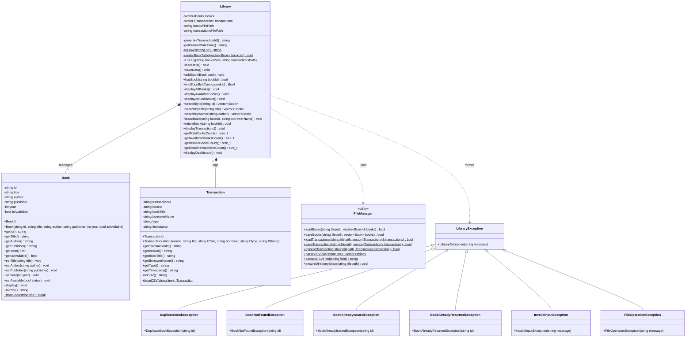
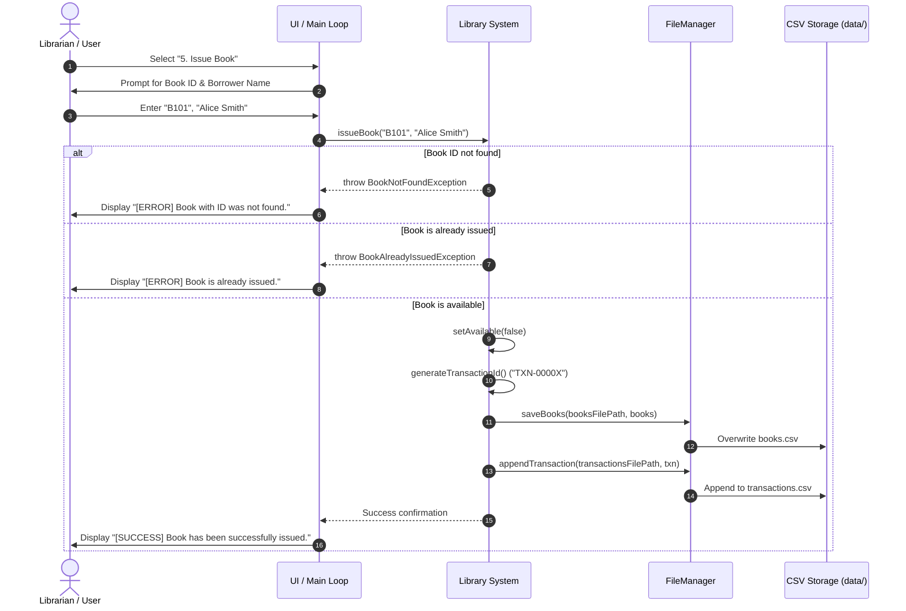
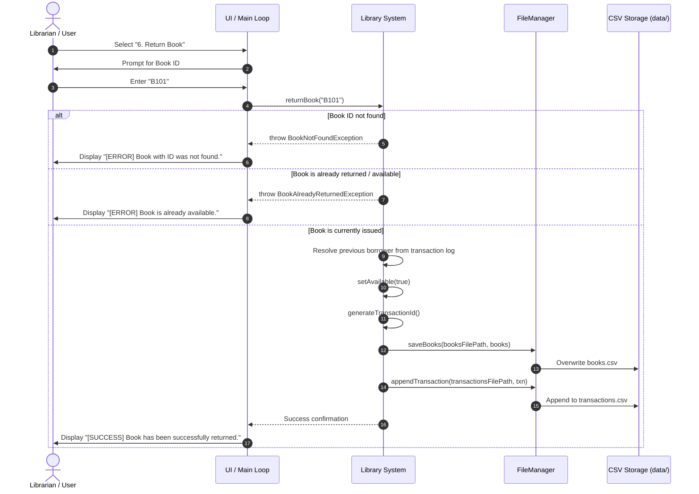

# Library Management System - UML Documentation

This document provides architectural and behavioral UML diagrams for the **Library Management System** implemented in C++17.

---

## 1. Class Diagram

---

## 2. Sequence Diagram: Book Issuance Flow

---

## 3. Sequence Diagram: Book Return Flow

